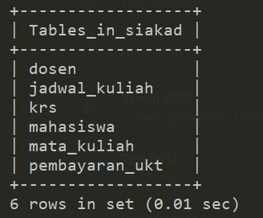
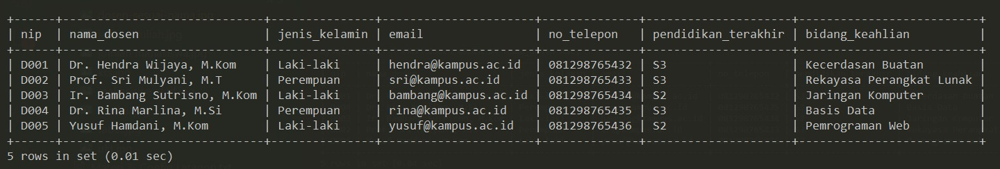
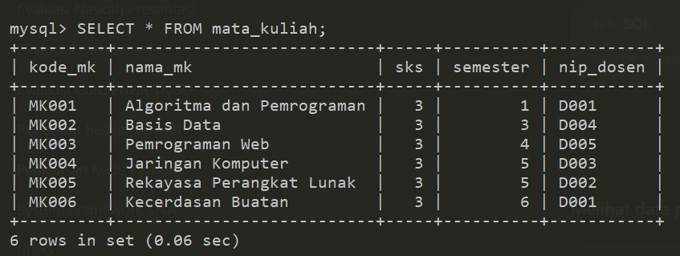
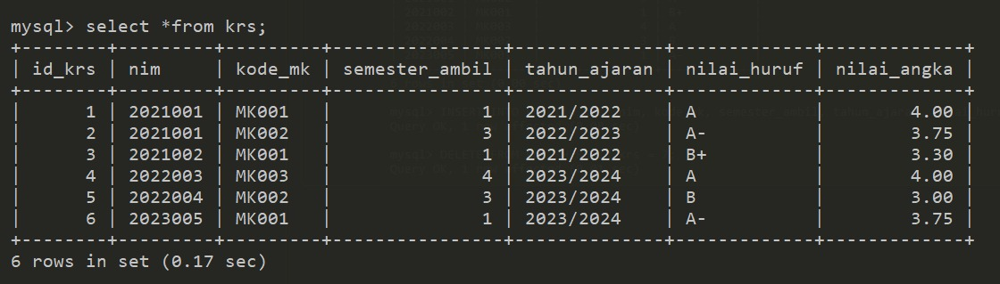
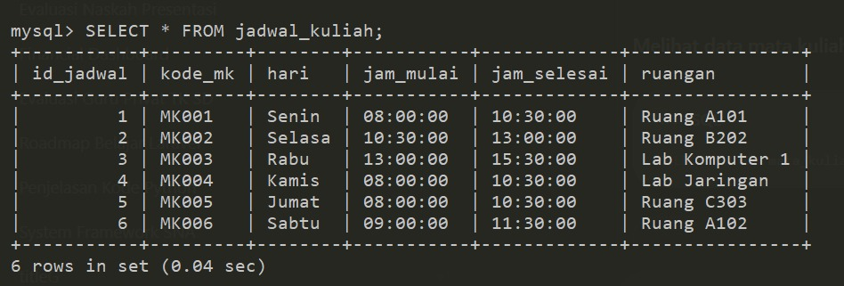
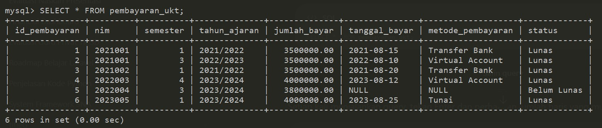
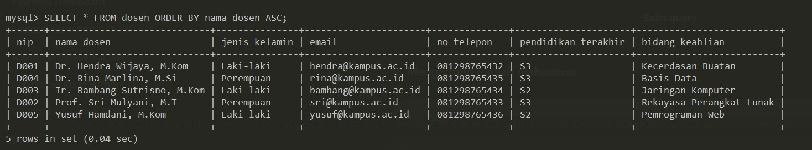
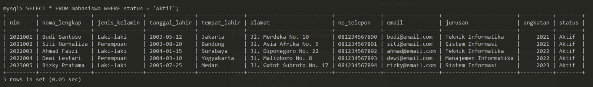
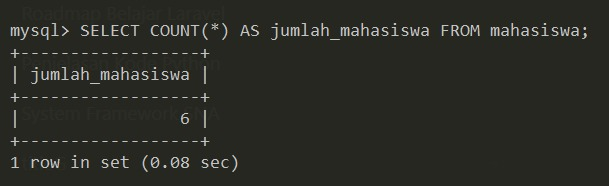
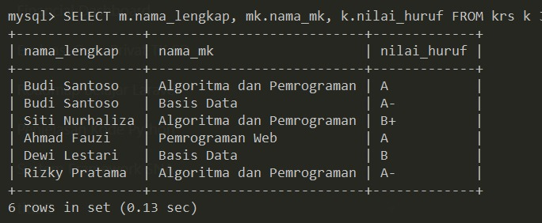

<div align="center">

# Sistem Basis Data

**Praktikum MySQL dan Pengelolaan Database SIAKAD**

Dokumentasi latihan dasar SQL, pengelolaan database relasional, dan hasil praktikum menggunakan MySQL pada Laragon.


</div>

---

## Identitas

| Keterangan | Data |
|---|---|
| Nama | Syauqi Nuzul Abdi |
| NIM | 202512042 |
| Mata Kuliah | Sistem Basis Data |

---

## Tujuan Praktikum

- Memahami konsep database relasional.
- Membuat dan memilih database MySQL.
- Memahami tabel, kolom, primary key, dan foreign key.
- Menambahkan data dummy ke dalam tabel.
- Menjalankan query SQL dasar.
- Melakukan pencarian, pengurutan, agregasi, dan JOIN.
- Menampilkan serta mendokumentasikan hasil query melalui Terminal Laragon dan phpMyAdmin.

---

## Teknologi yang Digunakan

| Teknologi | Versi | Fungsi |
|---|---|---|
| Laragon | 2026 | Lingkungan pengembangan lokal |
| MySQL | 8.4.3 | Sistem manajemen basis data |
| phpMyAdmin | 5.2.3 | Antarmuka administrasi database berbasis web |
| Apache | - | Web server untuk menjalankan phpMyAdmin |
| PHP | 8.3.30 | Bahasa yang dibutuhkan phpMyAdmin |
| SQL | - | Bahasa untuk membuat, mengelola, dan mengambil data |

Encoding database: `utf8mb4` (collation `utf8mb4_general_ci`).

---

## Struktur Repository

```text
siakad-db/
├── docs/
│   ├── data krs-nama mahasiswa-matkul.jpg
│   ├── dosen-urut-nama.jpg
│   ├── dosen.jpg
│   ├── jadwal-kuliah.jpg
│   ├── jumlah-mahasiswa.jpg
│   ├── krs-join.jpg
│   ├── krs.jpg
│   ├── mahasiswa-aktif.jpg
│   ├── matkul.jpg
│   ├── tabel.jpg
│   └── ukt.jpg
├── Materi 3- Config Laragon.txt
├── materi 3- dummy data.sql
└── README.md
```

| Berkas | Keterangan |
|---|---|
| `materi 3- dummy data.sql` | Skrip pembuatan database `siakad`, enam tabel, dan data dummy |
| `Materi 3- Config Laragon.txt` | Catatan instalasi phpMyAdmin pada Laragon |
| `docs/` | Screenshot dokumentasi hasil praktikum |

---

## Struktur Database SIAKAD

Database **SIAKAD** (Sistem Informasi Akademik) terdiri dari enam tabel.

| Tabel | Fungsi | Primary Key | Kolom Utama |
|---|---|---|---|
| `mahasiswa` | Menyimpan data mahasiswa | `nim` | `nama_lengkap`, `jurusan`, `angkatan`, `status` |
| `dosen` | Menyimpan data dosen | `nip` | `nama_dosen`, `pendidikan_terakhir`, `bidang_keahlian` |
| `mata_kuliah` | Menyimpan informasi mata kuliah dan dosen pengampu | `kode_mk` | `nama_mk`, `sks`, `semester`, `nip_dosen` |
| `krs` | Menyimpan data pengambilan mata kuliah dan nilai mahasiswa | `id_krs` | `nim`, `kode_mk`, `tahun_ajaran`, `nilai_huruf`, `nilai_angka` |
| `jadwal_kuliah` | Menyimpan jadwal dan ruangan perkuliahan | `id_jadwal` | `kode_mk`, `hari`, `jam_mulai`, `jam_selesai`, `ruangan` |
| `pembayaran_ukt` | Menyimpan informasi pembayaran UKT mahasiswa | `id_pembayaran` | `nim`, `jumlah_bayar`, `metode_pembayaran`, `status` |

### Relasi Foreign Key

| Tabel | Kolom | Merujuk ke | Aturan |
|---|---|---|---|
| `mata_kuliah` | `nip_dosen` | `dosen.nip` | `ON UPDATE CASCADE`, `ON DELETE SET NULL` |
| `krs` | `nim` | `mahasiswa.nim` | `ON UPDATE CASCADE`, `ON DELETE CASCADE` |
| `krs` | `kode_mk` | `mata_kuliah.kode_mk` | `ON UPDATE CASCADE`, `ON DELETE CASCADE` |
| `jadwal_kuliah` | `kode_mk` | `mata_kuliah.kode_mk` | `ON UPDATE CASCADE`, `ON DELETE CASCADE` |
| `pembayaran_ukt` | `nim` | `mahasiswa.nim` | `ON UPDATE CASCADE`, `ON DELETE CASCADE` |

Tabel `krs` menjadi penghubung antara `mahasiswa` dan `mata_kuliah`.

---

## Cara Menjalankan Database

### Menyiapkan Laragon dan phpMyAdmin

Langkah berikut mengikuti berkas `Materi 3- Config Laragon.txt`.

1. Unduh dan instal Laragon dari [laragon.org/download](https://laragon.org/download).
2. Unduh phpMyAdmin dari [phpmyadmin.net](https://www.phpmyadmin.net/).
3. Ekstrak berkas phpMyAdmin ke folder `laragon/etc/apps`.
4. Ubah nama folder hasil ekstrak menjadi `phpmyadmin`, lalu restart Laragon.

### Mengimpor Database

1. Jalankan Laragon, lalu aktifkan Apache dan MySQL (**Start All**).
2. Buka phpMyAdmin melalui `http://localhost/phpmyadmin/`. Jika SSL Laragon aktif, gunakan `https://localhost/phpmyadmin/`.
3. Pilih database `siakad` di panel kiri jika sudah tersedia.
4. Jika belum ada, buka tab **Import**, pilih berkas `materi 3- dummy data.sql`, lalu klik **Import**.
5. Setelah impor selesai, buka database `siakad` dan pastikan keenam tabel muncul beserta datanya.

> **Perhatian:** berkas SQL ini memakai `CREATE DATABASE IF NOT EXISTS`, `USE siakad`, dan `DROP TABLE IF EXISTS` untuk setiap tabel. Mengimpor ulang akan **menghapus lalu membuat ulang** keenam tabel beserta seluruh datanya, sehingga perubahan data setelah impor pertama akan hilang.

---

## Kumpulan Perintah SQL

Setiap contoh diberi status pada kolom di bawah ini.

| Status | Arti |
|---|---|
| Terdokumentasi | Ada screenshot hasilnya di folder `docs/` |
| Contoh latihan | Belum ada screenshot; hasil yang diharapkan dihitung dari data dummy |

### Fungsi Perintah Dasar

| Perintah | Fungsi |
|---|---|
| `SELECT` | Memilih kolom yang ingin ditampilkan |
| `WHERE` | Menyaring baris berdasarkan kondisi |
| `ORDER BY` | Mengurutkan hasil (`ASC` naik, `DESC` turun) |
| `COUNT` | Menghitung jumlah baris |
| `GROUP BY` | Mengelompokkan baris yang memiliki nilai sama |
| `JOIN` | Menggabungkan data dari beberapa tabel berdasarkan kolom yang berelasi |

### 1. Perintah dasar database

Status: **terdokumentasi** (hasil `SHOW TABLES`).

```sql
SHOW DATABASES;
USE siakad;
SHOW TABLES;
```

Menampilkan daftar database, memilih database `siakad`, lalu menampilkan seluruh tabel di dalamnya.

### 2. Menampilkan seluruh data setiap tabel

Status: **terdokumentasi** untuk `dosen`, `mata_kuliah`, `krs`, `jadwal_kuliah`, dan `pembayaran_ukt`. Tabel `mahasiswa` belum memiliki screenshot penuh.

```sql
SELECT * FROM mahasiswa;
SELECT * FROM dosen;
SELECT * FROM mata_kuliah;
SELECT * FROM krs;
SELECT * FROM jadwal_kuliah;
SELECT * FROM pembayaran_ukt;
```

Tanda `*` berarti semua kolom. Hasilnya adalah seluruh baris pada tabel yang dipilih.

### 3. Mengurutkan nama dosen

Status: **terdokumentasi**.

```sql
SELECT * FROM dosen
ORDER BY nama_dosen ASC;
```

Hasil: lima dosen terurut dari nama A ke Z.

### 4. Filter mahasiswa aktif

Status: **terdokumentasi**.

```sql
SELECT * FROM mahasiswa
WHERE status = 'Aktif';
```

Hasil: lima mahasiswa berstatus `Aktif`. Satu mahasiswa berstatus `Cuti` tidak ikut tampil.

### 5. Menghitung jumlah mahasiswa

Status: **terdokumentasi**.

```sql
SELECT COUNT(*) AS jumlah_mahasiswa
FROM mahasiswa;
```

Hasil: `6`.

### 6. Menghitung jumlah mahasiswa per jurusan

Status: **contoh latihan**.

```sql
SELECT jurusan, COUNT(*) AS jumlah
FROM mahasiswa
GROUP BY jurusan;
```

Hasil yang diharapkan dari data dummy awal:

| jurusan | jumlah |
|---|---|
| Teknik Informatika | 3 |
| Sistem Informasi | 2 |
| Manajemen Informatika | 1 |

### 7. Menampilkan mata kuliah 3 SKS

Status: **contoh latihan**.

```sql
SELECT * FROM mata_kuliah
WHERE sks = 3;
```

Hasil yang diharapkan: seluruh enam mata kuliah, karena semuanya bernilai 3 SKS.

### 8. Mengurutkan nilai KRS dari tertinggi

Status: **contoh latihan**.

```sql
SELECT * FROM krs
ORDER BY nilai_angka DESC;
```

Hasil yang diharapkan: enam baris dengan `nilai_angka` berurutan 4.00, 4.00, 3.75, 3.75, 3.30, 3.00.

### 9. Menampilkan pembayaran UKT yang lunas

Status: **contoh latihan**.

```sql
SELECT * FROM pembayaran_ukt
WHERE status = 'Lunas';
```

Hasil yang diharapkan: lima pembayaran. Satu pembayaran berstatus `Belum Lunas` tidak tampil.

### 10. Menampilkan jadwal hari Senin

Status: **contoh latihan**.

```sql
SELECT * FROM jadwal_kuliah
WHERE hari = 'Senin';
```

Hasil yang diharapkan: satu jadwal, yaitu `MK001` di `Ruang A101` pukul 08:00 sampai 10:30.

### 11. JOIN KRS, mahasiswa, dan mata kuliah

Status: **terdokumentasi** untuk gabungan tiga tabel ini. Screenshot menampilkan kolom yang sedikit berbeda dari query di bawah.

```sql
SELECT
    m.nama_lengkap,
    mk.nama_mk,
    k.nilai_huruf,
    k.nilai_angka
FROM krs k
JOIN mahasiswa m ON k.nim = m.nim
JOIN mata_kuliah mk ON k.kode_mk = mk.kode_mk;
```

Hasil: enam baris berisi nama mahasiswa, nama mata kuliah, dan nilainya.

---

## Dokumentasi Hasil Praktikum

### Struktur dan Data Tabel

**Daftar tabel dalam database `siakad`**



**Tabel `dosen`**



**Tabel `mata_kuliah`**



**Tabel `krs`**



**Tabel `jadwal_kuliah`**



**Tabel `pembayaran_ukt`**



### Pengurutan dan Filter

**Dosen diurutkan berdasarkan nama**



**Mahasiswa berstatus Aktif**



### Agregasi

**Jumlah mahasiswa**



### JOIN

**JOIN `krs`, `mahasiswa`, dan `mata_kuliah`**



**Data KRS dengan nama mahasiswa, mata kuliah, dan nilai**


---

## Menjalankan Query melalui Terminal Laragon

Terminal Laragon (Cmder) menerima dua jenis perintah yang berbeda.

| Jenis | Dijalankan di | Contoh |
|---|---|---|
| Perintah shell | Terminal biasa | `mysql -u root -p` |
| Perintah SQL | Prompt `mysql>` | `USE siakad;` |

Masuk ke MySQL dari terminal (shell):

```bash
mysql -u root -p
```

Setelah prompt `mysql>` muncul, jalankan perintah SQL:

```sql
USE siakad;
SHOW TABLES;
SELECT * FROM dosen;
```

Perintah `mysql -u root -p` hanya dijalankan di terminal shell. Perintah `USE`, `SHOW TABLES`, dan `SELECT` dijalankan setelah masuk ke dalam MySQL.

---

## Hasil Praktikum

| Objek | Jumlah |
|---|---|
| Tabel database | 6 |
| Data mahasiswa | 6 |
| Data dosen | 5 |
| Data mata kuliah | 6 |
| Data KRS | 6 |
| Data jadwal kuliah | 6 |
| Data pembayaran UKT | 6 |

Angka di atas adalah jumlah pada data dummy awal dan dapat berubah jika data ditambah, diubah, atau dihapus.

---

## Kesimpulan

Praktikum ini memberi pemahaman tentang database relasional, yaitu data disimpan dalam beberapa tabel yang saling terhubung melalui primary key dan foreign key. Query dasar `SELECT`, `WHERE`, dan `ORDER BY` digunakan untuk menampilkan, menyaring, dan mengurutkan data, sedangkan `COUNT` dan `GROUP BY` untuk merangkum data. `JOIN` menggabungkan data dari beberapa tabel dalam satu hasil. phpMyAdmin memudahkan pengelolaan database secara visual, sementara Terminal Laragon melatih penggunaan MySQL melalui baris perintah.

---

## Catatan

Repository ini merupakan dokumentasi praktikum akademik.